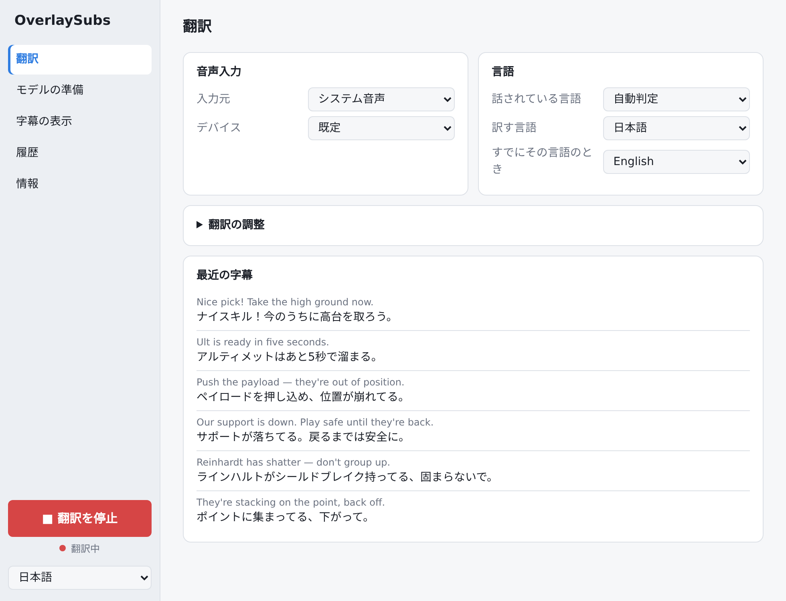
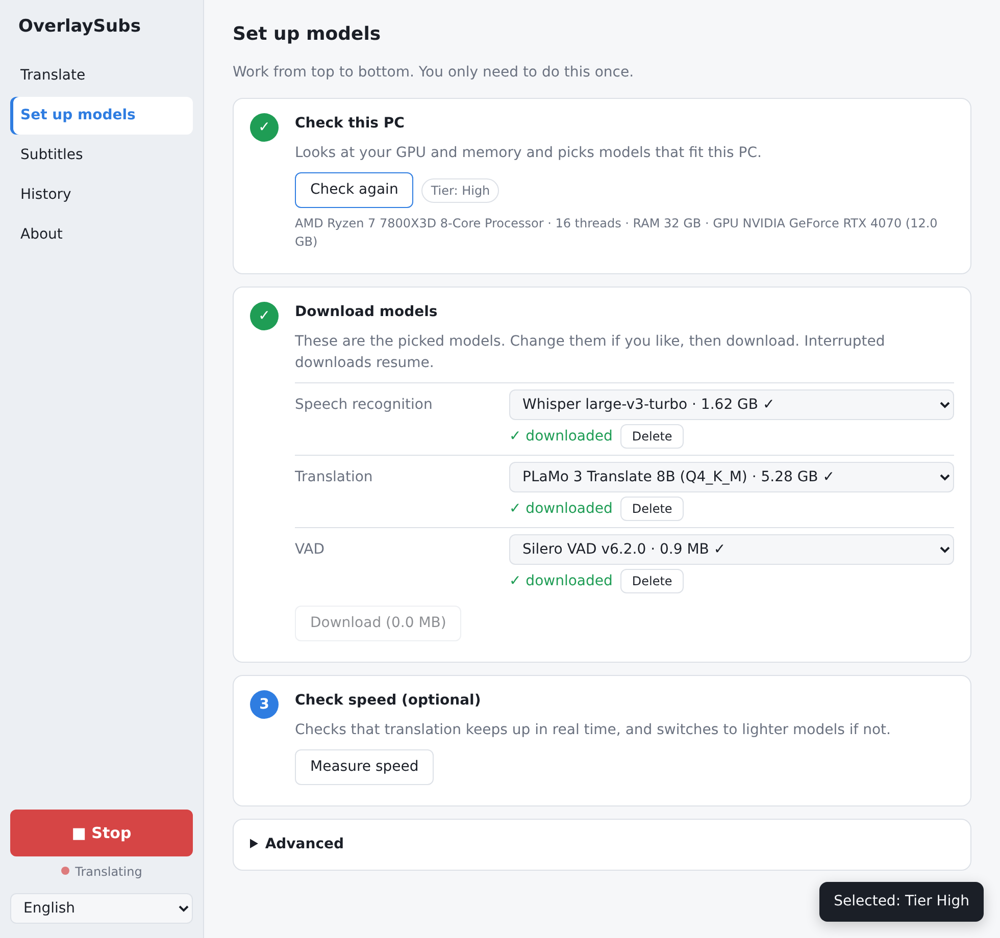
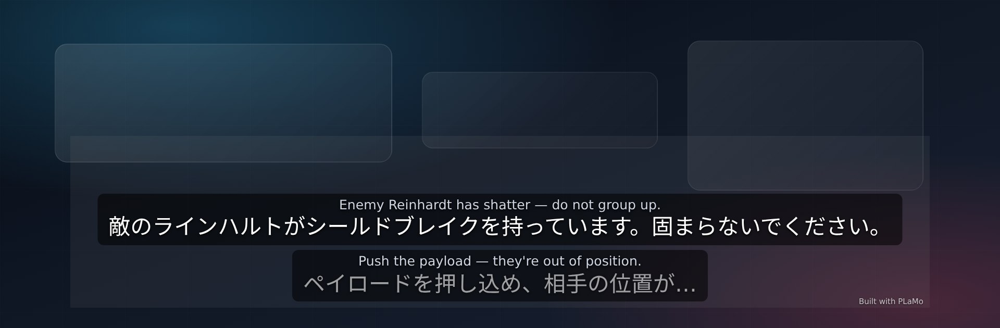

# OverlaySubs

**English** · [日本語](README.ja.md)

[](https://github.com/sp-yduck/overlaysubs/actions/workflows/ci.yml)
[](https://github.com/sp-yduck/overlaysubs/releases/latest)
[](LICENSE)
[](#requirements)
[](#requirements)

A desktop app that transcribes and translates any audio playing on your PC in real time and shows the result as an overlay of subtitles. Audio and text are processed locally on your device — no API key is needed, and no audio or text is sent to an external service.

**Built with PLaMo.** Translation uses Preferred Networks' [PLaMo 3 Translate](https://huggingface.co/pfnet/plamo-3-translate-0.8b-GGUF).

## Screenshots

**Settings** — translation options, languages and recent subtitles.
[](docs/images/ui-settings.png)

**Model setup** — on first run the app detects your hardware, picks a tier and downloads the matching models.
[](docs/images/ui-model-setup.png)

**Subtitle overlay** — drawn on top of other apps; click-through is available in the settings (background is illustrative).
[](docs/images/overlay.jpg)

## For users (download and install)

**You do not need a GitHub account.** If you just want to use the app, follow the instructions on the official site.

- Official site (download, install, usage, FAQ, uninstall, license): <https://sp-yduck.github.io/overlaysubs/>
- Windows 10 / 11 (x64): [overlaysubs-windows-x64-setup.exe](https://github.com/sp-yduck/overlaysubs/releases/latest/download/overlaysubs-windows-x64-setup.exe) (recommended)
- Windows (MSI): [overlaysubs-windows-x64.msi](https://github.com/sp-yduck/overlaysubs/releases/latest/download/overlaysubs-windows-x64.msi) (installs per-machine and asks for Administrator; the `.exe` is recommended)
- macOS 13+ (Apple Silicon): [overlaysubs-macos-arm64.dmg](https://github.com/sp-yduck/overlaysubs/releases/latest/download/overlaysubs-macos-arm64.dmg) (no Intel Mac build)
- Checksums: [SHA256SUMS.txt](https://github.com/sp-yduck/overlaysubs/releases/latest/download/SHA256SUMS.txt) / releases: <https://github.com/sp-yduck/overlaysubs/releases/latest>

Install steps, what to do when Windows SmartScreen or macOS Gatekeeper warns you, SHA-256 verification, usage, the FAQ, and uninstalling are all on the official site:
[Install](https://sp-yduck.github.io/overlaysubs/#install) / [Warnings](https://sp-yduck.github.io/overlaysubs/#warning) / [Usage](https://sp-yduck.github.io/overlaysubs/#usage) / [FAQ](https://sp-yduck.github.io/overlaysubs/#faq) / [Uninstall](https://sp-yduck.github.io/overlaysubs/#uninstall) / [License and terms](https://sp-yduck.github.io/overlaysubs/#license)

> The builds are **not signed with an Apple Developer ID or a Windows code-signing certificate, and not notarized** (the macOS app is ad-hoc signed only), so SmartScreen / Gatekeeper warn on first launch. That does not mean the app is unsafe. See [Warnings](https://sp-yduck.github.io/overlaysubs/#warning) on the site, and never disable Gatekeeper or SmartScreen system-wide.

## Contents

- [Screenshots](#screenshots)
- [Requirements](#requirements)
- [Architecture](#architecture)
- [Features](#features)
- [Models and tiers](#models-and-tiers)
- [Build](#build)
- [Tests](#tests)
- [Contributing](#contributing)
- [License](#license)

## Requirements

| | Windows | macOS |
|---|---|---|
| OS | Windows 10 / 11 (64-bit) | macOS 13 Ventura or later |
| CPU | x64 (Intel / AMD) | Apple Silicon (M1 or later) |
| GPU | **Recommended: Vulkan-capable GPU with an up-to-date driver** (runs on the CPU without one) | Integrated GPU (Metal) |
| Memory | 8 GB or more | 8 GB or more |
| Free disk space | Model download size (see [Models and tiers](#models-and-tiers)) | Same |

- You do **not** need to install a Vulkan runtime to start the Windows app: the installer ships Khronos' Vulkan loader (`vulkan-1.dll`, Apache-2.0), because the official `--features vulkan` build links `vulkan-1` at load time. On a PC with no Vulkan-capable GPU or with an old driver the loader finds no device and the app runs on the CPU (use the CPU-tier models; it is slower).
- A **Vulkan-capable GPU with a current driver is strongly recommended** for real-time speed. With an old driver the GPU is not used and performance is not usable in real time.
- There is no Intel Mac build, no 32-bit Windows build, and no Windows on ARM build.
- The only supported distribution channel is **GitHub Releases**; there is no silent auto-updater. The app notifies you when a newer release exists and, unless turned off, downloads its installer in the background; it is installed only when you ask.

## Architecture

```
WASAPI loopback (Windows) / ScreenCaptureKit system audio (macOS) / microphone ─▶ 16 kHz mono ─▶ Silero VAD endpointer ─▶ whisper.cpp ─▶ PLaMo 3 Translate (llama.cpp) ─▶ overlay
```

- `crates/core` holds engine-independent logic: tier selection, model definitions, PFML3 prompts, utterance segmentation, sessions, sentence-level translation, and SRT export. Run `cargo test -p overlaysubs-core`.
- `src-tauri` is the Tauri app: audio capture, whisper.cpp / llama.cpp adapters, model downloads, tray, hotkeys, and settings persistence.
- `ui` is the settings window and overlay: plain HTML/JS/CSS with no build step; `ui/i18n.js` holds the Japanese, English and Chinese (Traditional and Simplified) strings.
- The ASR and translation engines sit behind the `session::Asr` / `session::Translator` traits and can be swapped.
- `models.json` defines the models (URL, size, SHA-256, tier). URLs are pinned to Hugging Face commits (using `main` would break the hash when upstream re-uploads). Placing a `models.json` in the config folder overrides the bundled one without an app update.
- `licenses/` ships the OverlaySubs Terms of Use (English and Japanese); `THIRD_PARTY_NOTICES.md` lists the bundled libraries' licenses. The PLaMo Community License (revised November 9, 2026) is not bundled; the app and docs link to the official page instead.

## Features

- First run asks you to accept the OverlaySubs Terms of Use. Acceptance is stored in `terms-accepted` and not asked again until the terms version changes. "Check this PC" in the settings window detects your hardware and picks a tier (High / Mid / Low / CPU). The result is cached in `hardware.json`, so later launches show it without probing again; "Check again" re-runs the check.
- Models download from Hugging Face automatically, resume after interruption, and are verified with SHA-256. No account or token required.
- You can run the optional speed check (benchmark); if it cannot keep up in real time, it switches to one tier lower.
- Audio input is system audio or a microphone. Windows captures system audio with WASAPI loopback; on macOS 13+ system audio is captured directly with ScreenCaptureKit, so no loopback / virtual-audio device (such as BlackHole) is needed. "App audio" translates only one chosen app when several are playing sound (Windows 10 version 2004 or later, via WASAPI process loopback; macOS via a ScreenCaptureKit app filter). The microphone works on both platforms. The first time you use system audio on macOS, allow OverlaySubs under System Settings → Privacy & Security → "Screen & System Audio Recording" (macOS 15+) or "Screen Recording" (macOS 13–14), then restart the app. Changing the audio input takes effect after you stop and start translation again.
- Source language auto-detect or fixed. You can pick the target language and the "if already in that language" language, so English↔Japanese and Korean↔Japanese work together. Changing the languages while translating takes effect from the next utterance.
- Previous utterances are passed as context and translation happens per sentence. Glossary, a free-text topic hint, and Japanese plain/polite style are configurable. Changing the translation tuning while translating takes effect from the next utterance.
- Partial results are dimmed; final translations stream in and replace them.
- Always-on-top, semi-transparent overlay (click-through can be enabled in settings). The overlay and caption background colors and opacities; the translation's font, size, color, weight and line height; whether to show the original text and its size and color; the caption alignment, vertical position and line count; and how long subtitles stay after updates stop are all adjustable. When the lines are taller than the overlay, the scrollbar on the right or the mouse wheel scrolls through them (the wheel moves half a line per notch; with click-through off). While the subtitles keep updating, older lines stay until the line count pushes them out. The overlay appears while translating and hides when translation stops; you can also toggle it from "Show subtitles" in the tray menu or with the switch above the Start button. While translation is stopped, opening "Subtitles" shows the overlay with a sample caption so you can tune the appearance live.
- Browser source: turn on "Serve the subtitles to a browser source" under "Subtitles" and add the URL shown there (default `http://127.0.0.1:17777/`) as a browser source in your streaming software. The subtitles appear on a transparent background with the appearance set in the app (the overlay background color is left out); position and size are set in the streaming software. If its browser source has a custom CSS field, that can override the look for the stream only, for example `:root { --size: 40px !important; }`. The server is off by default, listens on this PC only (127.0.0.1), and sends the subtitles and their appearance settings to whatever connects from this PC. If the port is taken, change it in the same place.
- Export history as text or SRT.
- Tray/menu-bar resident, global hotkey (default `CmdOrCtrl+Shift+T`; `Ctrl+Shift+T` on Windows, `Cmd+Shift+T` on macOS) to start/stop. UI in English, Japanese and Chinese (Traditional and Simplified); the first launch picks one from the OS language settings, and falls back to English. The Terms of Use exist only in Japanese and English, so the Chinese UI shows the English version.
- At startup the app makes one anonymous request to the GitHub Releases API to check for a newer version; if there is one, a dismissible banner in the settings window shows the latest and current version with "Open release page" and "Later" buttons. With "Download new versions automatically" on (About page, on by default) the installer for your platform is downloaded from the GitHub release in the background and verified with the SHA-256 GitHub publishes for it; the banner shows the progress and then offers "Quit and install" (with the setting off, a "Download" button in the banner starts the same download), which starts the installer and quits the app. Nothing is installed without that click, and if the check or the download fails (offline, API error) only the release page link is shown, or nothing. Dismissing the banner lasts until the app restarts.
- Audio, transcripts, and translations are never sent anywhere. No telemetry. The only network access is the model download and one anonymous GitHub API request at startup to check for a newer release (it sends no account, token, or personal data; if it fails, nothing happens). The app works offline once the models are downloaded.

## Models and tiers

The tier is decided when you run "Check this PC" in first-run setup, and the models for that tier are selected automatically. The settings window lets you change the individual Whisper / PLaMo / VAD models. The detection result is cached; run "Check again" after changing the hardware, such as a new GPU.

Each of the three models also has a **Runs on** choice — **Auto / GPU / CPU** — in the settings window where the backend supports it: Whisper and PLaMo can use either, while VAD is CPU-only upstream (whisper.cpp forces GPU VAD off). "Auto" uses the GPU when one was detected and the CPU otherwise; if loading a model on the GPU fails, the app retries it on the CPU. A model or Runs-on change takes effect the next time you start translating.

| Tier | Detected when | Whisper | PLaMo 3 Translate | First download |
|---|---|---|---|---|
| High | VRAM 12 GB+ / Apple Silicon RAM 32 GB+ | large-v3-turbo | 8B Q4_K_M | ~6.9 GB |
| Mid | VRAM 8 GB / Apple Silicon RAM 16 GB | large-v3-turbo Q5_0 | 2B Q4_K_M | ~2.4 GB |
| Low | VRAM 4–6 GB / Apple Silicon RAM 8 GB | small | 2B Q4_K_M | ~2.3 GB |
| CPU | No GPU, or VRAM under 4 GB | base | 0.8B Q4_K_M | ~0.7 GB |

- Sizes are the sum of the declared sizes in `models.json` (including the ~0.9 MB Silero VAD). Allow about 10 GB free for High, 5 GB for Mid/Low, and 2 GB for CPU.
- Mid uses 2B instead of 8B because keeping Whisper and 8B Q4_K_M (5.3 GB) together in 8 GB of VRAM leaves no headroom for gaming. You can switch to 8B Q3_K_M or 31B manually in the settings window.
- The benchmark is optional. If you run it and the machine cannot keep up in real time, it suggests one tier lower and can switch to it.

## Build

Prerequisites: Rust stable (edition 2021). On Windows, MSVC + Windows SDK, CMake, LLVM / libclang (for bindgen), and WebView2. The **Vulkan SDK is only needed for `--features vulkan`** (the official GPU build); the loader from it must be copied into `src-tauri/libs/` before bundling (see below), and a build without GPU features is a CPU-only build that needs no Vulkan SDK. On macOS, Xcode 26 or Command Line Tools with the macOS 26 SDK: the ScreenCaptureKit bindings compile a small Swift bridge at build time, and the Metal dependency they link needs the macOS 26 SDK. Source builds need a Swift toolchain. Release CI selects the preinstalled Xcode 26 on the `macos-15` runner. Node.js is only needed to run the Tauri CLI through `npx` (not for the app itself).

```bash
# Windows (Vulkan, same as the official build)
npx --yes @tauri-apps/cli@2.12.4 build --features vulkan

# Windows (CPU only; needs no Vulkan SDK)
npx --yes @tauri-apps/cli@2.12.4 build

# macOS (Metal)
npx --yes @tauri-apps/cli@2.12.4 build --features metal

# NVIDIA
npx --yes @tauri-apps/cli@2.12.4 build --features cuda
```

You can also `cargo install tauri-cli --version "^2" --locked` and use `cargo tauri build`. CI uses the prebuilt `npx @tauri-apps/cli@2.12.4` because `cargo install tauri-cli` took up to 19 minutes.

whisper.cpp and llama.cpp both embed ggml, so statically linking both into one process clashes on symbols. llama.cpp is therefore linked as a shared library (`dynamic-link` in `llama-cpp-2`) and shipped inside the installer.

- Windows: `src-tauri/libs/*.dll` is bundled via `bundle.resources`. `src-tauri/libs/` is gitignored, so before bundling copy llama.cpp's build output (`target/release/build/llama-cpp-sys-2-*/out/bin/*.dll`) into `src-tauri/libs/`; for `--features vulkan` also copy the Khronos Vulkan loader that the SDK's Vulkan Runtime installer (bundled with SDK 1.4.313.1+) placed in `"%SystemRoot%\System32\vulkan-1.dll"`. `overlaysubs.exe` has a load-time import of `vulkan-1.dll`, so an installer built with Vulkan features but without the loader fails to start on PCs that have no Vulkan runtime. The CI steps are in `.github/workflows/release.yml`.
- macOS: `beforeBundleCommand` runs `scripts/stage-dylibs.sh`, which collects the dylibs into `target/frameworks`; `bundle.macOS.files` ships them in `Frameworks`.
- `THIRD_PARTY_NOTICES.md` is bundled too (see `src-tauri/tauri.windows.conf.json` and `tauri.macos.conf.json`).
- macOS: `src-tauri/Info.plist` is merged into the bundle's generated Info.plist (`bundle.macOS.infoPlist`). It declares the microphone and screen/system-audio usage strings (`NSMicrophoneUsageDescription` / `NSScreenCaptureUsageDescription`).

## Tests

The network-free core tests run in CI (`.github/workflows/ci.yml`) on pull requests.

```bash
cargo test -p overlaysubs-core   # tiers, model registry, PFML3, endpointer, session, SRT
cargo test -p overlaysubs        # src-tauri unit tests
```

The end-to-end test with real models is `#[ignore]`d by default (it needs a 16 kHz mono WAV and downloads ~0.7 GB of models).

```bash
OVERLAYSUBS_WAV=path/to/16k-mono.wav cargo test -p overlaysubs -- --ignored
```

To measure what a change does to speed and quality, run the benchmark on the same clips before and after it. It replays the clips as live audio and reports the engine load, the caption delay and the character error rates; `scripts/bench.sh` documents the inputs.

```bash
scripts/bench.sh clips/                              # on main: writes target/bench/<commit>.json
scripts/bench.sh clips/ target/bench/<commit>.json   # on your branch: compares with that report
```

Pushing a `v*` tag makes the release workflow build the bundles and publish them to GitHub Releases; see [RELEASING.md](RELEASING.md).

## Contributing

- [CONTRIBUTING.md](CONTRIBUTING.md) — dev environment, tests, PR flow
- [SECURITY.md](SECURITY.md) — how to report vulnerabilities privately
- [RELEASING.md](RELEASING.md) — release process (maintainers)
- [docs/index.html](docs/index.html) — end-user documentation (the GitHub Pages source: English `docs/index.html`, Japanese `docs/ja/index.html`, shared CSS `docs/style.css`; `docs/en/index.html` is a redirect stub for old links). The English page is self-contained with no external CDN, fonts, or JS.
- Issue templates: [bug report](.github/ISSUE_TEMPLATE/bug_report.yml) / [feature request](.github/ISSUE_TEMPLATE/feature_request.yml)

## License

- **The app code is MIT licensed** ([LICENSE](LICENSE)).
- Use of the app is governed by the [OverlaySubs Terms of Use](licenses/overlaysubs-terms.en.txt) ([Japanese](licenses/overlaysubs-terms.ja.txt)). You accept them on first launch, and they are also available from "About" in the app.
- Use of the PLaMo 3 Translate translation model is governed by the [PLaMo Community License](https://plamo.preferredai.jp/info/plamo-community-license-en), revised by Preferred Networks on November 9, 2026. The license is not bundled; the app and docs link to the official text.
- Personal and academic use of the model is free. Commercial use, including use inside a company or other organization, requires prior registration with Preferred Networks; it is free while your or your affiliates' most recent fiscal year revenue or sales is 1 billion yen or less, and a separate license agreement is required above that.
- The revised license does not require attribution when you publish translated subtitles. For books, papers and similar long-form publications, state that PLaMo was used for translation; if you distribute subtitle data (for example as a dataset), state that the license applies to any model trained on it.
- If you publish subtitles for streams or videos, mind the copyright of the source content.
- Whisper models (MIT) and Silero VAD (MIT) follow their own licenses.
- Third-party licenses for the bundled whisper.cpp / llama.cpp / ggml (MIT) and the Windows Vulkan loader `vulkan-1.dll` (Apache-2.0) are listed in [THIRD_PARTY_NOTICES.md](THIRD_PARTY_NOTICES.md).
